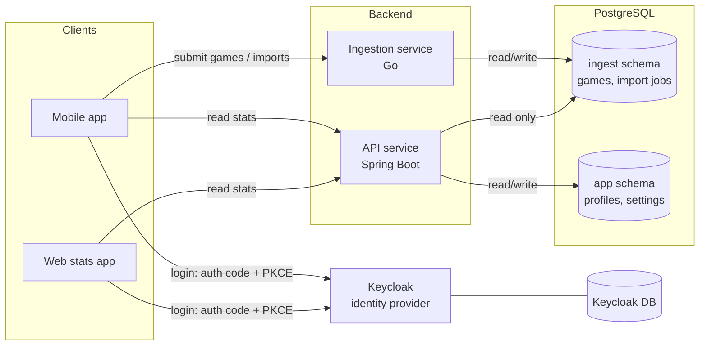

# <Project Name>

Track every game you play and see what your results say about you, whether you have five games or five thousand.

This organization holds the backend services, clients and infrastructure for the platform. This page explains how the pieces fit together and why they are built this way.

> **Status:** planning / early development. Repository names below are proposals.

---

## Architecture at a glance

| Component | Tech | Responsibility |
|---|---|---|
| **Ingestion service** | Go | Accepts game events and bulk imports; the only writer of game data |
| **API service** | Spring Boot | Serves games, per-user stats and global stats; owns user profiles |
| **Keycloak** | Keycloak (self-hosted) | Registration, login, tokens, social login, MFA |
| **PostgreSQL** | Postgres | Shared database, split into schemas with a single owner each |
| **Mobile / Web** | Clients | Authenticate with Keycloak, call the two backend services |

All three backend components are connected only by the user id in the token (`sub`). No service reads another service's tables for writing, and nothing reads Keycloak's tables.

---

## Design principles

1. **One writer per table.** Every table has exactly one owning service that writes to it and runs its migrations. Other services get `SELECT` at most.
2. **Idempotent ingestion.** Submitting the same game twice is harmless. Retries are always safe.
3. **Async for big work.** Small submissions are synchronous. Large imports become jobs processed in the background.
4. **No infrastructure before it's needed.** No message broker until a second consumer of game events exists.
5. **Identity is external.** Keycloak owns users. Our services only know the `sub` claim.

---

## Ingestion service (Go)

### Expected load

- Most users have a few games; veterans may have thousands.
- Total volume is modest for Postgres (tens of millions of rows is fine with proper indexes).
- The real challenge is **bursts**: a veteran's first import can send thousands of games at once.

### Two ingestion paths

**Small batches (normal play):**

1. Client sends `POST /games` with one or more games.
2. Service inserts the batch in one transaction.
3. Responds `2xx` only after commit. On any failure the client retries.

**Bulk imports (thousands of games):**

1. Client calls `POST /imports`.
2. Service stores the payload (or a pointer to its source) and creates a job row with status `pending`.
3. Responds `202 Accepted` with the job id.
4. A pool of workers claims jobs with `SELECT ... FOR UPDATE SKIP LOCKED` (Postgres as a queue).
5. Workers insert in chunks of 500–1,000 (`pgx` `CopyFrom` or batched `INSERT`) and record progress, so a crash resumes instead of restarting.
6. Client checks progress via `GET /imports/{id}`.

This provides retries, backpressure, crash recovery and visible status without a broker.

### Idempotency

- Unique constraint on `(user_id, external_game_id)`.
- All inserts use `INSERT ... ON CONFLICT DO NOTHING`.
- Duplicate submissions, retries and re-imports produce no duplicates.

### Cache invalidation signal

After each successful batch, the service updates a per-user `last_ingested_at` value. The API service includes it in its cache keys, so new games automatically bypass stale cached stats.

### Suggested libraries

| Purpose | Library |
|---|---|
| Postgres driver | `jackc/pgx/v5` |
| Migrations | `pressly/goose` or `golang-migrate/migrate` |
| Token validation | `coreos/go-oidc/v3` or `lestrrat-go/jwx` |

---

## API service (Spring Boot)

- **Reads** game data from the `ingest` schema (read-only DB privileges).
- **Writes** only its own data in the `app` schema: user profiles, settings and similar.
- **Computes per-user stats on read.** Aggregating one user's games, even thousands, is fast with the right indexes. Results are cached (Caffeine, or Redis with multiple instances), keyed by user and `last_ingested_at`.
- **Computes global stats periodically.** Cross-user stats (hero win rates, matchups, meta) scan everyone's data. They live in materialized views refreshed on a schedule with `REFRESH MATERIALIZED VIEW CONCURRENTLY`.
- **Creates profiles just in time.** On a user's first authenticated request, the service upserts a profile row for their `sub`.

Key dependencies: `spring-boot-starter-oauth2-resource-server`, Flyway or Liquibase for the `app` schema.

---

## Authentication (Keycloak)

### Responsibilities

Keycloak handles registration, login, passwords, email verification, social login and MFA. It runs with its **own database**. Our services never read Keycloak's tables; the token and, if needed, the Admin API are the only interfaces.

### Clients

| Client | Type | Flow |
|---|---|---|
| Mobile app | Public | Authorization Code + PKCE via system browser (e.g. AppAuth) |
| Web stats app | Public (or confidential with a backend-for-frontend) | Authorization Code + PKCE |
| Service-to-service (if ever needed) | Confidential | Client Credentials |

The password grant ("direct access grants") is disabled.

### Token validation

- Both backend services validate JWTs **locally** against Keycloak's JWKS. No per-request call to Keycloak.
- An **audience mapper** adds the API audiences (e.g. `games-api`, `ingest-api`) to access tokens. Each service rejects tokens not addressed to it.
- The user id always comes from the token's `sub`, never from the request body.
- Access tokens are short-lived (5–15 minutes) with refresh tokens.

### Operations

- Run in production mode (`kc.sh build` + `start --optimized`), never `start-dev`, behind a reverse proxy with HTTPS.
- Budget roughly 0.5–1 GB of RAM.
- The realm configuration (clients, mappers, roles) is exported and **kept in version control**.

---

## Database

One PostgreSQL instance for application data, split by schema:

| Schema | Owner (writes + migrations) | Tables | Other access |
|---|---|---|---|
| `ingest` | Ingestion service | games, import jobs, per-user ingestion metadata | API service: `SELECT` |
| `app` | API service | profiles, settings, materialized views | Ingestion service: none |
| Keycloak DB | Keycloak | internal | none |

Rules:

- Each service connects with its own DB user; privileges enforce ownership.
- `user_id` columns store the Keycloak `sub` (UUID). There is no cross-schema foreign key to a users table.
- Schema changes to `ingest` tables are treated as a contract with the API service: add first, remove only after the API no longer reads the column.

### Key indexes

- `ingest.games (user_id, played_at)` for timelines and recent form
- `ingest.games (user_id, external_game_id)` unique, for idempotency
- Additional `(user_id, <dimension>)` indexes as stats queries require (hero, format, opponent)

---

## When to add a message broker

Not now. Revisit when any of these become true:

- A second consumer needs to react to new games (achievements, notifications, external integrations).
- Sustained throughput exceeds what direct database writes handle comfortably.
- Producers must keep accepting events while the database is unavailable.

When that happens:

- Prefer a lightweight broker (**NATS JetStream** or **Redis Streams**) over Kafka.
- Publish via the **transactional outbox pattern**: write the game and an outbox row in one transaction, then publish from the outbox.

---

## Repositories

| Repository | Contents |
|---|---|
| `ingest-service` | Go ingestion service and `ingest` schema migrations |
| `api-service` | Spring Boot API and `app` schema migrations |
| `auth` | Keycloak realm export, themes, extensions |
| `infra` | Docker Compose for local development, deployment configuration |
| `mobile` | Mobile app |
| `web` | Web stats app |

---

## Roadmap

- [ ] **Infra:** local stack with Docker Compose (Postgres, Keycloak, both services)
- [ ] **Auth:** Keycloak realm, clients, audience mapper; realm export in `auth`
- [ ] **Ingestion:** schema, idempotent `POST /games`, JWT middleware
- [ ] **Ingestion:** import jobs with `SKIP LOCKED` workers and progress tracking
- [ ] **API:** resource server setup, JIT profiles, per-user stats with caching
- [ ] **API:** global stats via materialized views and scheduled refresh
- [ ] **Clients:** login with PKCE, game submission, stats screens
- [ ] **Later:** broker + outbox, once a second consumer exists

---

## Open questions

- **Source of games:** pushed by the mobile app, pulled from an external source, or both? Pulling turns the ingestion service into a scheduled importer with rate limiting, sync checkpoints and backoff.
- **Profile creation:** is just-in-time enough, or do we need a Keycloak event listener for signup-time actions?
